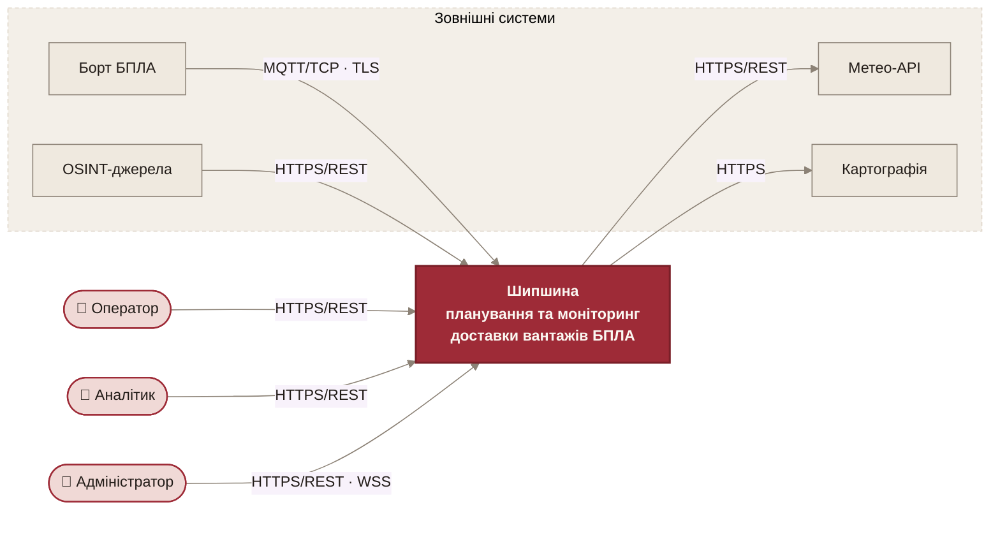
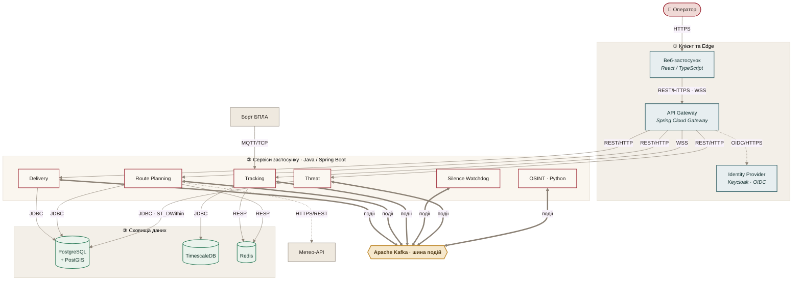
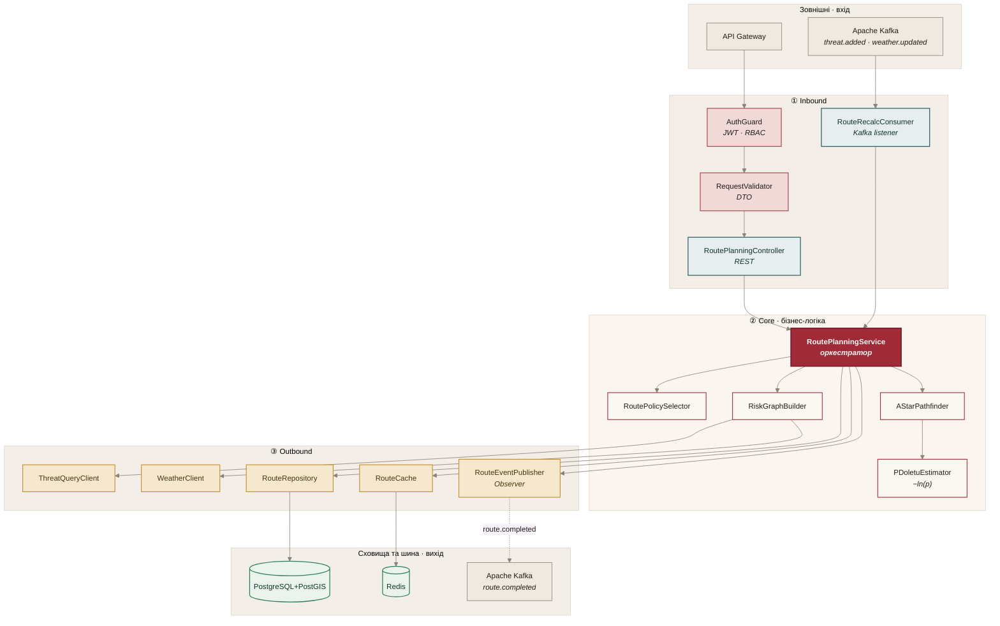
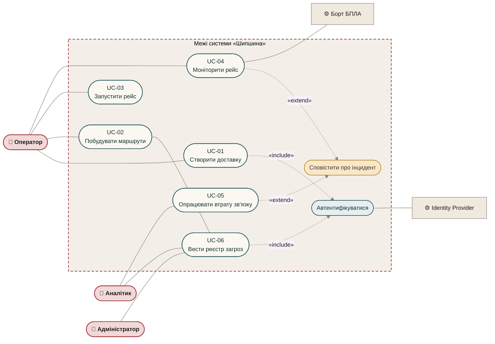
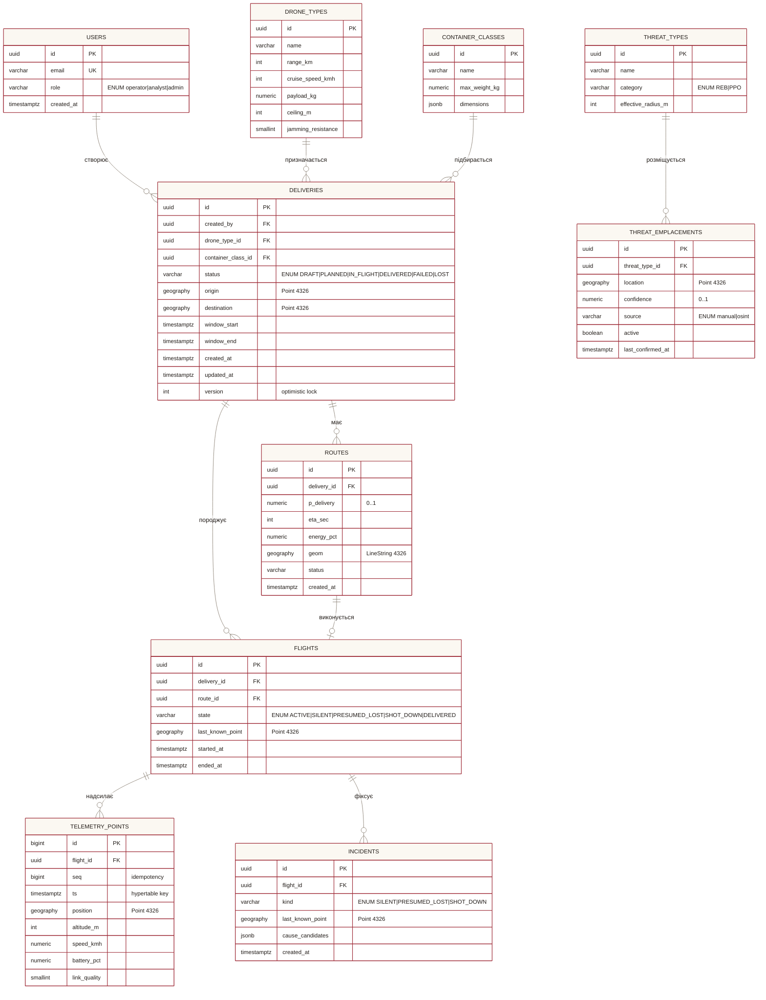
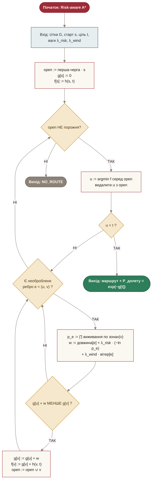
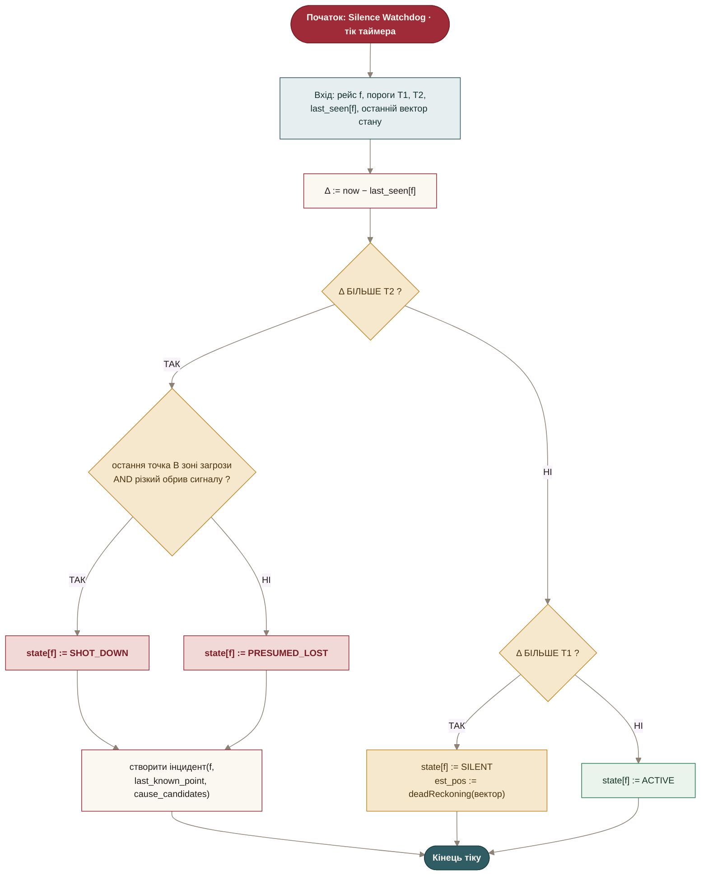

# Розділ 2. Проєктування та обґрунтування архітектурних рішень

Проєктування архітектури системи «Шипшина» за методологією Docs-as-Code. Усі діаграми виконано як
Diagrams-as-Code (Mermaid.js) і рендеряться безпосередньо в інтерфейсі GitHub. Документ побудовано
з наскрізним трасуванням вимог ([`srs.md`](srs.md)) в архітектуру та рішення ([`adr/`](adr/)).

## 2.1 Обґрунтування архітектурного стилю та патернів

**Макро-стиль.** Для системи обрано **модульний моноліт на основі event-driven взаємодії** з
винесенням навантажених компонентів (трекінг телеметрії, планувальник маршрутів, OSINT) у окремі
сервіси. Такий вибір технічно забезпечує виконання NFR-вимог: горизонтальне масштабування трекінгу
та планувальника незалежно одне від одного задовольняє [SRS-NFR-PERF-03](srs.md#srs-nfr-perf-03)
(≥ 300 одночасних рейсів), а асинхронна шина подій (Apache Kafka) розв'язує синхронну залежність
«зміна загрози → перерахунок маршрутів» і підтримує [SRS-NFR-PERF-04](srs.md#srs-nfr-perf-04)
(перерахунок ≤ 5 с). Внутрішня структура сервісів підпорядкована принципам **Clean Architecture**
та **DDD**: доменне ядро ізольоване від інфраструктури, що знижує зв'язність (Coupling) і робить
бізнес-логіку незалежною від СУБД та брокера.

**Мікро-патерни (рівень коду).** У критичних сервісах застосовано:

- **Repository** — ізоляція доступу до даних (`RouteRepository`), доменне ядро не залежить від JDBC;
- **Dependency Injection / Dependency Inversion** — залежності спрямовані до ядра, зовнішні системи
  підключаються через інтерфейси-клієнти (`ThreatQueryClient`, `WeatherClient`);
- **Strategy** — вибір політики маршруту (`RoutePolicySelector`: безпека / час / заряд) без
  розгалужень у ядрі;
- **Observer** — публікація подій (`RouteEventPublisher`) розв'язує сервіси через шину;
- **Circuit Breaker** — запобігає каскадним збоям при тимчасовій недоступності сервісу
  ([SRS-NFR-REL-02](srs.md#srs-nfr-rel-02)): відкриття кола ізолює відмову й повертає graceful
  degradation замість блокування потоку.

## 2.2 Контекстне та контейнерне моделювання системи (C4 Model: Levels 1–2)

### C4 Level 1 — System Context Diagram

Система «Шипшина» розглядається як єдиний блок у взаємодії з ролями користувачів (Оператор,
Аналітик, Адміністратор) через HTTPS/REST та WSS, приймає телеметрію з борту БПЛА (MQTT/TCP, TLS)
і звертається до зовнішніх сервісів погоди, OSINT та картографії (HTTPS/REST).

### C4 Level 2 — Container Diagram

**Контейнери та протоколи.** Веб-застосунок (React/TS) взаємодіє з API Gateway через REST/HTTPS і
WSS. API Gateway (Spring Cloud Gateway) виконує маршрутизацію (REST/HTTP), валідацію токенів через
Identity Provider (OIDC/HTTPS) та rate limiting. Бізнес-сервіси (Java/Spring Boot; OSINT — Python)
взаємодіють асинхронно через Apache Kafka (Kafka/TCP). Сховища: PostgreSQL+PostGIS (JDBC/TCP, SQL;
у Threat Service — ST_DWithin), TimescaleDB (треки), Redis (RESP/TCP).

**Трасування SRS → контейнери:** [SRS-FUN-01](srs.md#srs-fun-01) → Delivery; SRS-FUN-02/03 → Route
Planning; [SRS-FUN-04](srs.md#srs-fun-04) → Tracking; SRS-FUN-05 → Silence Watchdog; SRS-FUN-06/07 →
Threat (+ OSINT); [SRS-FUN-08](srs.md#srs-fun-08) → API Gateway + Identity Provider.

## 2.3 Компонентне моделювання та опис серверного ядра (C4 Model: Level 3)

Критичним сервісом для декомпозиції обрано **Route Planning Service**.

**Шари Clean Architecture.** Inbound: `RoutePlanningController` (REST) та `RouteRecalcConsumer`
(Kafka); вхідний трафік проходить крізь `AuthGuard` (JWT/RBAC) і `RequestValidator` (DTO). Core:
`RoutePlanningService` (оркестратор), `RiskGraphBuilder`, `AStarPathfinder`, `PDoletuEstimator`,
`RoutePolicySelector`. Outbound: `ThreatQueryClient`, `WeatherClient`, `RouteRepository`,
`RouteCache`, `RouteEventPublisher` (Observer). Cross-cutting: `MetricsInterceptor`,
`GlobalErrorHandler`. Контролери не звертаються напряму до репозиторіїв — доступ до даних лише через
Service, що забезпечує ізоляцію доменного ядра.

## 2.4 Контур безпеки програмного рішення (Application Security)

Контур AppSec реалізує оборону за принципом defense-in-depth на рівні коду серверного ядра та
задовольняє [SRS-NFR-SEC-01..03](srs.md#srs-nfr-sec-01).

- **Автентифікація та сесії.** OAuth 2.0 / OIDC (Keycloak); на вході сервісу `AuthGuard` валідує
  підпис JWT (RS256) за публічним ключем JWKS; access-токен TTL ≤ 15 хв, refresh — rotation.
- **Хешування секретів.** Паролі службових акаунтів — **Argon2id** (memory-hard, параметри
  m=64 MiB, t=3, p=1); жодних самописних схем шифрування.
- **Валідація вхідних даних.** `ValidationPipe` на рівні DTO блокує Mass Assignment (whitelist
  полів), перевіряє `minimum`/`maximum`/`pattern`; відхиляє не описані в контракті поля.
- **Авторизація.** RBAC/ABAC `Guards` на кожному контролері; перевірка прав за роллю
  (operator/analyst/admin) та власністю ресурсу (ABAC) запобігає BOLA/IDOR.
- **Захист периметра.** Rate Limiting на API Gateway (напр. 100 req/хв на токен) проти Brute-Force /
  DoS; CORS-політика з явним allow-list походжень; обмеження Max Body Size на завантаження.
- **Аудит та спостережуваність безпеки.** `Audit Logging` усіх дій із загрозами й рейсами у
  незмінний журнал; інциденти безпеки (невдалі автентифікації, 401/403) експортуються в OTel.
- **Покриття OWASP API Security Top-10:** BOLA → ABAC Guards; Broken Auth → OIDC+JWT; Mass
  Assignment → ValidationPipe; відсутність rate limiting → Gateway; security misconfiguration →
  SAST (SonarQube) + сканування образів (Trivy) у CI ([SRS-NFR-SEC-03](srs.md#srs-nfr-sec-03)).

## 2.5 Специфікація міжсервісних контрактів та топологія API-маршрутів

Повну специфікацію інтерфейсів оформлено за підходом API-First Design у файлі
[`api/openapi.yaml`](api/openapi.yaml) (OpenAPI 3.0). Контракт містить схеми запитів/відповідей,
схему авторизації `bearerAuth` (JWT) та структуру обробки помилок (4xx/5xx).

### Карта інтерфейсних маршрутів системи (API topology)

| ID | Метод / RPC | Топологічний шлях (URI) | Вхідні параметри / Payload | Контейнер-обробник |
|---|---|---|---|---|
| API-REQ-01 | POST | `/api/v1/deliveries` | `CreateDeliveryRequest` (body) | Delivery Service |
| API-REQ-02 | POST | `/api/v1/deliveries/{id}/routes` | `PlanRoutesRequest` (body, path id) | Route Planning Service |
| API-REQ-03 | GET | `/api/v1/flights/{id}/track` | path id; query `from`, `to` | Tracking Service |
| API-REQ-04 | POST | `/api/v1/threats` | `ThreatEmplacementRequest` (body) | Threat Service |
| API-REQ-05 | GET | `/api/v1/threats?bbox=` | query `bbox`, `page`, `limit` (≤ 100) | Threat Service |
| API-EVT-06 | Kafka | topic `telemetry.received` | `TelemetryPoint` (Avro) | Tracking → Kafka |

### Потоки даних (Data Flows)

**DF-1. Створення доставки → маршрут.** Крок 1: клієнтський Frontend надсилає `CreateDeliveryRequest`
через HTTPS POST на `/api/v1/deliveries`. Крок 2: API Gateway перехоплює запит, валідує JWT
(bearerAuth) та застосовує rate limit. Крок 3: Delivery Service зберігає доставку (JDBC, транзакція)
та публікує `delivery.created` у Kafka. Крок 4: Route Planning Service будує маршрути й повертає
масив із `p_delivery` для кожного.

**DF-2. Телеметрія в реальному часі.** Борт БПЛА → Tracking Service (MQTT/TCP) → topic
`telemetry.received` (Kafka) → споживачі Tracking (WSS до оператора), Silence Watchdog (таймери),
Analytics. Обробка ідемпотентна за `(flightId, seq)` ([SRS-NFR-REL-03](srs.md#srs-nfr-rel-03)).

**Мережеві обмеження:** Max Body Size запиту — 2 MiB (10 MiB для завантаження файлів); пагінація
обов'язкова для списків (`limit` ≤ 100); CORS allow-list; усі маршрути, що змінюють стан
(POST/PUT/DELETE), вимагають Bearer-токен.

## 2.6 Моделювання користувацького досвіду (Use Cases)

### Специфікації прецедентів

**UC-01 — Створити доставку.** Primary Actor: Оператор. Secondary: Identity Provider.
*Preconditions:* користувач автентифікований (роль operator); є ≥ 1 доступний тип дрона.

| Крок | Дія Актора | Реакція та відповідь системи |
|---|---|---|
| 1 | Задає точки призначення та параметри посилки | `ValidationPipe` перевіряє DTO; підбирає сумісний `container_class` (SQL-запит) |
| 2 | Підтверджує створення | Delivery Service відкриває транзакцію, зберігає `status := DRAFT`, публікує `delivery.created` |

*Postconditions:* доставка у стані DRAFT; подію опубліковано в Kafka.

**AF-01A (Alternative, UC-01).** Старт із кроку 1. Умова-тригер: обраний тип дрона не покриває
дальність до точки призначення. Обробка: система відхиляє підбір, пропонує сумісні типи дрона;
повернення на крок 1.

**EF-01A (Exception, UC-02 — побудова маршруту).** Умова: Threat Service повернув timeout під час
просторового запиту. Технічні дії сервера: circuit breaker розмикає коло після N збоїв, запит
повторюється (retry з backoff) до 3 разів; за вичерпання — повернення помилки `503` з кодом
`ROUTE_DEPENDENCY_UNAVAILABLE`, транзакція не фіксується (Rollback), стан системи узгоджений.

## 2.7 Проєктування та документування моделей даних (ERD)

**Специфікація сутностей (витяг).**

- **DELIVERIES** — ядро транзакційної моделі. PK `id` (uuid). FK: `created_by`→USERS,
  `drone_type_id`→DRONE_TYPES, `container_class_id`→CONTAINER_CLASSES. `status` — тип ENUM (а не
  VARCHAR) для цілісності станів. `origin`/`destination` — `geography(Point, 4326)`. Поле `version`
  реалізує optimistic locking; `created_at`/`updated_at` — аудит.
- **THREAT_EMPLACEMENTS** — розміщення загроз. `location` — `geography(Point, 4326)` з **GiST-індексом**
  для запиту «загрози в коридорі» ([SRS-FUN-07](srs.md#srs-fun-07)). `source` ENUM `manual|osint`
  розрізняє походження; `confidence` та `last_confirmed_at` — свіжість даних.
- **TELEMETRY_POINTS** — гіпертаблиця TimescaleDB, ключ партиціювання `ts`. `seq` забезпечує
  ідемпотентність; індекс за `(flight_id, ts)`.

**План індексації:** GiST на всіх `geography`-полях (B-Tree недоцільний для просторових запитів);
B-Tree на FK та `status`; BRIN на `telemetry_points.ts` (великий монотонний часовий ряд).

## 2.8 Моделювання логіки критичних вузлів

### Алгоритм 1 — Risk-aware A* (побудова маршруту з P_долету)

Логарифмічне перетворення `−ln(p_e)` робить мультиплікативну ймовірність виживання адитивною, тому
класичний A* безпосередньо максимізує `P_долету`. Евристика `h` — гаверсинус до цілі (допустима,
бо ризик лише додає вартості понад геометрію).

### Алгоритм 2 — Silence Watchdog (детекція мовчання та класифікація втрати)

Двоетапні таймери `T1`/`T2` відокремлюють тимчасове мовчання каналу від остаточної втрати. Логічні
умови блоків розгалуження використовують оператори `AND`/`OR`; присвоєння позначено `:=`; індекси
масивів — `state[f]`, `last_seen[f]`.

## 2.9 Інтеграційний аудит та верифікація цілісності доменів (Production Readiness)

Проведено перехресний контроль узгодженості трьох артефактів: моделі даних (2.7), API-контрактів
(2.5) та логіки алгоритмів (2.8).

**Перевірка «API ↔ Database».** Типи полів у `openapi.yaml` звірено зі схемою БД: `p_delivery`
(`number`, 0..1) ↔ `numeric`; `status` (`enum`) ↔ ENUM у БД (а не VARCHAR); ідентифікатори —
`uuid`/`string(uuid)`; часові мітки — `string(date-time)` ↔ `timestamptz`. Розбіжностей немає.

**Перевірка «Logic ↔ API/Database».** Алгоритм маршруту оперує `p_e` та зонами загроз — відповідні
поля (`threat_emplacements.location`, `effective_radius_m`) наявні в БД та доступні через
`ThreatQueryClient`. Стан `state[f]` з алгоритму 2 відповідає ENUM `flights.state`.

**Production Readiness Report.** Специфікації Розділу 2 узгоджені й готові до реалізації (Розділ 3):
критичних блокерів інтеграції (Showstoppers) не виявлено; типи даних консистентні між шарами; усі
функціональні вимоги SRS мають архітектурний елемент-обробник; контури безпеки та спостережуваності
визначені. Статус готовності архітектурного ядра — **Approved for implementation**.

## Висновки до розділу 2

У розділі виконано наскрізне проєктування архітектури системи за методологією Docs-as-Code.
Обґрунтовано вибір модульного event-driven стилю з елементами Clean Architecture та визначено
мікро-патерни (Repository, DI, Strategy, Observer, Circuit Breaker), що безпосередньо задовольняють
нефункціональні вимоги щодо масштабованості, latency та відмовостійкості.

Побудовано ієрархічну модель C4 (рівні 1–3), специфіковано контур безпеки застосунку (OWASP,
Argon2id, Guards, Audit Logging), міжсервісні контракти (OpenAPI) з топологією маршрутів і потоками
даних, поведінковий контур (Use Cases з Happy/Alternative/Exception Flows), логіко-фізичну модель
даних (ERD з типами, ключами та планом індексації) та логіку критичних алгоритмів у формі блок-схем.

Проведений інтеграційний аудит підтвердив узгодженість типів даних і сутностей між схемою БД,
API-контрактами та логікою алгоритмів; критичних конфліктів інтеграції не виявлено. Спроєктоване
архітектурне ядро є повним, внутрішньо несуперечливим і готовим до програмної реалізації, що
становитиме предмет розділу 3.
