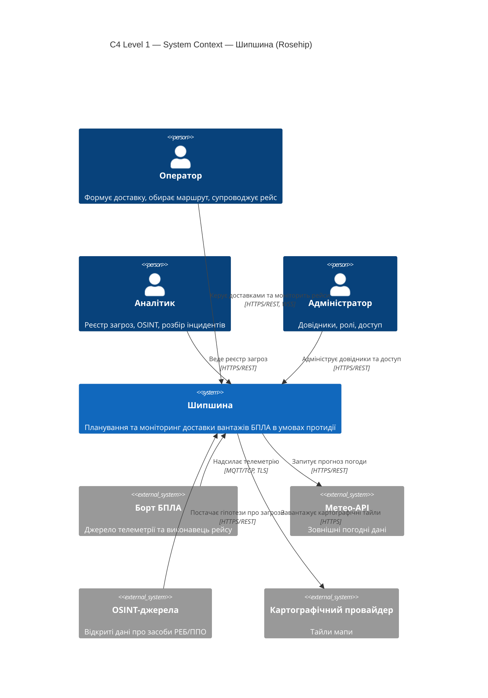
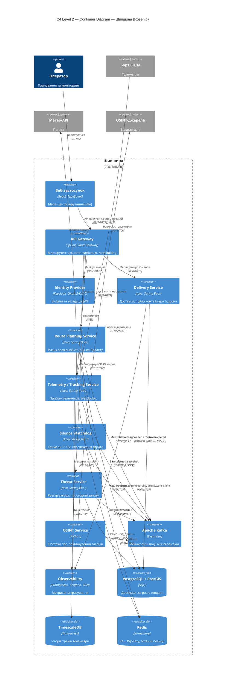

# Розділ 2. Проєктування архітектури системи

Ієрархічне моделювання архітектури системи «Шипшина» за методологією Саймона Брауна (C4 Model,
рівні 1–3) у підході Diagrams-as-Code (Mermaid.js). Діаграми рендеряться безпосередньо в інтерфейсі
GitHub (Rich Diff / Preview).

## 2.1 Контекстне та контейнерне моделювання системи (C4 Model)

### C4 Level 1 — System Context Diagram

Система «Шипшина» взаємодіє з ролями користувачів (Оператор, Аналітик, Адміністратор) через
HTTPS/REST та WSS, приймає телеметрію з борту БПЛА (MQTT/TCP, TLS) і звертається до зовнішніх
сервісів погоди, OSINT та картографії (HTTPS/REST).

### C4 Level 2 — Container Diagram

**Контейнери та протоколи.** Веб-застосунок (React/TS) взаємодіє з API Gateway через REST/HTTPS та
WSS. API Gateway (Spring Cloud Gateway) виконує маршрутизацію (REST/HTTP), валідацію токенів через
Identity Provider (OIDC/HTTPS) та rate limiting. Бізнес-сервіси (Java/Spring Boot; OSINT — Python)
взаємодіють асинхронно через Apache Kafka (Kafka/TCP). Борт БПЛА надсилає телеметрію в Tracking
Service (MQTT/TCP). Сховища: PostgreSQL+PostGIS (JDBC/TCP, SQL), TimescaleDB (треки), Redis
(RESP/TCP). Спостережуваність — через OTLP/gRPC.

## 2.2 Компонентне моделювання критичного сервісу (C4 Component)

Критичним сервісом обрано **Route Planning Service** (основне обчислювальне навантаження).

```mermaid
C4Component
    title C4 Level 3 — Component Diagram — Route Planning Service
    System_Ext(gatewayExt, "API Gateway", "Маршрутизує REST-запити")
    System_Ext(kafkaExt, "Apache Kafka", "Шина подій")
    System_Ext(threatExt, "Threat Service", "Просторові запити загроз")
    System_Ext(meteoExt, "Метео-API", "Погода")
    ContainerDb(pgExt, "PostgreSQL + PostGIS", "SQL", "Маршрути, гео")
    ContainerDb(redisExt, "Redis", "In-memory", "Кеш Pдолету")

    Container_Boundary(planner, "Route Planning Service") {
        Component(ctrl, "RoutePlanningController", "Spring REST", "Inbound: REST-запити на побудову маршрутів")
        Component(consumer, "RouteRecalcConsumer", "Kafka Listener", "Inbound: threat.added / weather.updated")
        Component(guard, "AuthGuard", "Spring Security filter", "Перевірка JWT та прав RBAC")
        Component(validator, "RequestValidator", "Middleware", "Валідація вхідних DTO")
        Component(svc, "RoutePlanningService", "Core / Service", "Оркестрація сценарію побудови")
        Component(graph, "RiskGraphBuilder", "Core", "Будує ризик-зважений граф над сіткою")
        Component(astar, "AStarPathfinder", "Core", "A* з гаверсинус-евристикою")
        Component(pdolet, "PDoletuEstimator", "Core", "Композиція −ln(p) по зонах загроз")
        Component(policy, "RoutePolicySelector", "Core", "λ-політики: безпека / час / заряд")
        Component(threatClient, "ThreatQueryClient", "Outbound", "Клієнт Threat Service")
        Component(weatherClient, "WeatherClient", "Outbound", "Клієнт Метео-API")
        Component(repo, "RouteRepository", "Outbound", "Доступ до PostgreSQL/PostGIS")
        Component(cache, "RouteCache", "Outbound", "Доступ до Redis")
        Component(publisher, "RouteEventPublisher", "Outbound / Observer", "Публікація route.completed")
        Component(metrics, "MetricsInterceptor", "Cross-cutting", "OpenTelemetry-трасування")
        Component(errh, "GlobalErrorHandler", "Cross-cutting", "Централізована обробка помилок")
    }

    Rel(gatewayExt, guard, "REST-запит", "REST/HTTP")
    Rel(guard, validator, "Пропускає автентифіковані", "in-process")
    Rel(validator, ctrl, "Валідований запит", "in-process")
    Rel(kafkaExt, consumer, "Події", "Kafka/TCP")
    Rel(ctrl, svc, "Викликає", "DI / interface")
    Rel(consumer, svc, "Запускає перерахунок", "DI / interface")
    Rel(svc, graph, "Будує граф", "DI")
    Rel(svc, policy, "Обирає політику", "DI")
    Rel(graph, threatClient, "Запитує загрози в коридорі", "DI")
    Rel(graph, weatherClient, "Запитує погоду", "DI")
    Rel(svc, astar, "Пошук шляху", "DI")
    Rel(astar, pdolet, "Оцінка ребра", "DI")
    Rel(svc, repo, "Зберігає маршрут", "DI")
    Rel(svc, cache, "Читає/пише кеш", "DI")
    Rel(svc, publisher, "Повідомляє про результат", "Observer")
    Rel(threatClient, threatExt, "Запит", "REST/HTTP")
    Rel(weatherClient, meteoExt, "Запит", "HTTPS/REST")
    Rel(repo, pgExt, "SQL", "JDBC/TCP")
    Rel(cache, redisExt, "Команди", "RESP/TCP")
    Rel(publisher, kafkaExt, "route.completed", "Kafka/TCP")
    UpdateLayoutConfig($c4ShapeInRow="3", $c4BoundaryInRow="1")
```

**Шари Clean Architecture.** Inbound: `RoutePlanningController` (REST) та `RouteRecalcConsumer`
(Kafka); вхідний трафік проходить крізь `AuthGuard` (JWT/RBAC) і `RequestValidator` (DTO). Core:
`RoutePlanningService` (оркестратор), `RiskGraphBuilder`, `AStarPathfinder`, `PDoletuEstimator`,
`RoutePolicySelector`. Outbound: `ThreatQueryClient`, `WeatherClient`, `RouteRepository`,
`RouteCache`, `RouteEventPublisher` (Observer). Cross-cutting: `MetricsInterceptor`,
`GlobalErrorHandler`. Взаємодія між шарами — через Dependency Injection та інтерфейси (Dependency
Inversion); контролери не звертаються напряму до репозиторіїв.

## 2.3 Архітектурні рішення (ADR)

Ключовий інженерний компроміс зафіксовано у форматі Architecture Decision Record (шаблон Майкла
Нігардза): [ADR-001 — Вибір PostgreSQL + PostGIS як геопросторового ядра](adr/0001-choice-of-technology.md)
(статус **Approved**).

## Трасування вимог в архітектуру (Cross-linking)

Нижче наведено явні гіперпосилання між архітектурними елементами, вимогами SRS та рішеннями ADR,
що перетворює документацію на єдину інженерну екосистему.

- Контейнер **Delivery Service** (C4 Level 2) реалізує функціональну вимогу
  [SRS-FUN-01](srs.md#srs-fun-01).
- Контейнер **Route Planning Service** (C4 Level 2) реалізує
  [SRS-FUN-02](srs.md#srs-fun-02) та [SRS-FUN-03](srs.md#srs-fun-03) і має вкладатися в
  [SRS-NFR-PERF-04](srs.md#srs-nfr-perf-04).
- Контейнер **Telemetry / Tracking Service** реалізує [SRS-FUN-04](srs.md#srs-fun-04) з огляду на
  [SRS-NFR-PERF-02](srs.md#srs-nfr-perf-02).
- Контейнери **API Gateway + Identity Provider** реалізують [SRS-FUN-08](srs.md#srs-fun-08) та
  базуються на [SRS-NFR-SEC-01](srs.md#srs-nfr-sec-01).
- Компонент **ThreatQueryClient** (C4 Level 3) обслуговує [SRS-FUN-07](srs.md#srs-fun-07) через
  просторовий індекс; вибір сховища обґрунтовано в
  [ADR-001](adr/0001-choice-of-technology.md).
- Компонент **RouteEventPublisher** (Observer) забезпечує подієвий перерахунок
  [SRS-FUN-03](srs.md#srs-fun-03) відповідно до [SRS-NFR-REL-02](srs.md#srs-nfr-rel-02).
